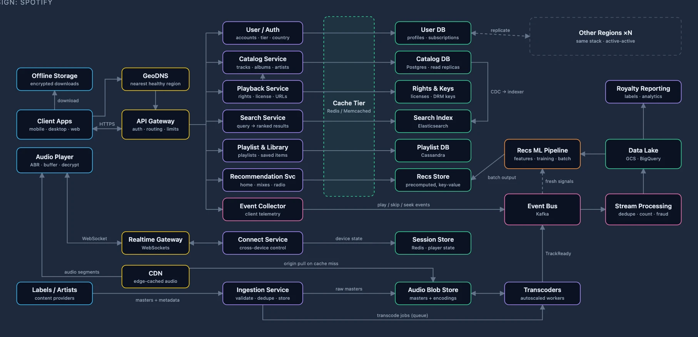

# System Design Slides

Animated slide decks that walk through classic **"Design X"** system design interview
questions the way a senior engineer would answer them at a whiteboard: a diagram that
grows one box at a time, with a script explaining each step.



## Decks

| Deck | What it covers |
|------|----------------|
| Dropbox | Content-addressed blocks with dedupe, a per-namespace metadata journal, long-poll notifications, conflicted copies, erasure-coded storage |
| Google Docs | Operational transformation, one session owner per document, an op log with snapshots, offline edits |
| Google Search | A polite, prioritized crawler, a sharded inverted index, scatter-gather with two-phase ranking, PageRank, a fresh tier for news |
| Slack | Tens of millions of WebSockets, per-channel ordering and fan-out, a database sharded by workspace |
| Spotify | CDN streaming, adaptive playback, royalties from play events, a deep dive into recommendations |
| Stripe | Tokenization into a PCI vault, idempotency keys, an explicit unknown state, a double-entry ledger, reconciliation |
| Ticketmaster | Seat holds without double-booking, exactly-once checkout, a virtual waiting room |
| Twitter / X | Fan-out on read vs. write, the celebrity problem, real-time search, trends, ranked feeds |
| Uber | A geo index of driver locations, ETA-based batch matching, the trip state machine, surge pricing |
| URL Shortener | Leased ID ranges as base-62 codes, a cache and CDN over a sharded store, click analytics off the hot path |

## How a deck flows

1. **Intro**: the complete system, so you see where the walkthrough is headed.
2. **Functional requirements**: one card per capability, then what's out of scope.
3. **Non-functional requirements**: scale, latency, availability and so on, then
   back-of-the-envelope estimates and the numbers that shape the design.
4. **Architecture**: starting from the simplest system (usually one client and one
   server), each slide adds one component, highlighted and faded in, and explains why
   it's there. Detail slides (sequence diagrams, data models, comparison tables) and
   zoomed-in sub-diagrams explain the harder steps along the way.

Each script is written to be read aloud; a full deck runs about 30–60 minutes.

## Getting started

Requires **Node.js 22.18 or later** (the scripts in `scripts/` are TypeScript run
directly by Node).

```bash
npm install
```

```bash
npm run dev
```

Then open the URL Vite prints (usually http://localhost:5173).

### Navigating

- **← / →** arrow keys, or the on-screen arrows, move between slides.
- The **home** button returns to the list of decks.
- The URL holds the slide number (`/#/<slug>/<n>`), so links and refreshes keep your
  place. For example, `/#/spotify/12` is slide 12 of the Spotify deck.

## Commands

| Command | What it does |
|---------|--------------|
| `npm run dev` | Start the local dev server |
| `npm run validate` | Check every deck JSON for errors (unknown ids, edges to missing boxes, unclosed markdown) and layout warnings |
| `npm run build` | Type-check and build a static site into `dist/` |
| `npm run preview` | Serve the built `dist/` locally |
| `npm run thumbnails` | Screenshot each deck's intro slide into `public/thumbnails/` for the index page (needs Google Chrome and a running dev server; set `CHROME` to use another path) |
| `node scripts/long-slides.ts <slug>` | List a deck's architecture slides whose script runs longer than 5 sentences |

The build uses relative asset paths, so `dist/` can be hosted from any sub-path
(GitHub Pages, S3, etc.).

## Project layout

```
public/decks/index.json     decks listed on the home page
public/decks/<slug>.json    one deck each (data only)
public/decks/example.json   the template for new decks (/#/example)
public/logos/, thumbnails/  images for the index page
src/types.ts                the deck JSON format, with comments on every field
src/lib/slides.ts           expands a deck into its slides
src/lib/scene.ts            the scene builder (visibility, highlighting, camera)
src/components/             diagrams, the deck page, and the index page
scripts/                    validation, thumbnails, and long-slide tooling
```

Every deck is **pure data**: a JSON file the app fetches at runtime. All rendering
code is shared, so every deck looks and behaves the same, and new features go into the
shared code rather than into one deck.

## Writing a new deck

1. Copy `public/decks/example.json` to `public/decks/<slug>.json`, where the slug is
   the topic kebab-cased (`"Google Docs"` → `google-docs`).
2. Fill in the `title`, `topic`, and `requirements`.
3. Declare the **final** system once in `scenes.main`: every box (`id`, position,
   `label`, `kind`) and edge (`from`, `to`, route points).
4. Write `slides`, where each one names only what it `add`s (or `remove`s), plus a
   `title` and `script`. The scene builder highlights and animates the new pieces,
   hides edges whose endpoints aren't visible yet, and fits the camera to what's shown.
5. Add the deck to `public/decks/index.json`.
6. Run `npm run validate`, then check every slide in the browser at 1440×900.

The field formats are documented in [`src/types.ts`](src/types.ts), and
[`CLAUDE.md`](CLAUDE.md) has the full authoring guide: layout conventions, box kinds,
detail slides, multiple scenes, and how to write the script.

### With Claude Code

This repo is set up for authoring with [Claude Code](https://claude.com/claude-code).
`CLAUDE.md` describes the whole workflow, and two project skills help tighten decks:

- `/expand-slide <slug> <n>` splits one long architecture slide into shorter steps
  with detail diagrams.
- `/expand-deck <slug>` runs that over every long slide in a deck.
